# Cañón del Galeón San José: reconstrucción y análisis digital de una pieza arqueológica

**Caso de estudio:** cómo pasar de un escaneo 3D incompleto de un cañón de bronce del siglo XVII a una réplica imprimible en resina, fiel a la pieza, y cómo **leer en el escaneo inscripciones** que a simple vista no se leen. Todo se hizo con herramientas abiertas (Python, PyMeshLab, SciPy y Blender) y con un asistente de IA (Claude Code) que programó y ejecutó cada paso bajo la dirección del autor.

> **Encargo:** réplica dorada de 220 mm para una placa conmemorativa de la Operación Poseidón/2025, la primera extracción de objetos del naufragio del Galeón San José (Cartagena de Indias, hundido en 1708).
> **Autor:** Brumet (diseño 3D). **Trabajo técnico:** octubre de 2026.

---

## Índice
1. [Punto de partida: un escaneo incompleto](#1-punto-de-partida-un-escaneo-incompleto)
2. [Medir el cañón en vez de inventarlo](#2-medir-el-cañón-en-vez-de-inventarlo)
3. [Rellenar la parte de abajo con la forma real](#3-rellenar-la-parte-de-abajo-con-la-forma-real)
4. [Trasplantar la textura real de la corrosión](#4-trasplantar-la-textura-real-de-la-corrosión)
5. [Los delfines: dos asas gemelas, un solo molde](#5-los-delfines-dos-asas-gemelas-un-solo-molde)
6. [Leer lo que no se ve: inscripciones y escudos](#6-leer-lo-que-no-se-ve-inscripciones-y-escudos)
7. [Hallazgos](#7-hallazgos)
8. [Lo que no funcionó (y por qué)](#8-lo-que-no-funcionó-y-por-qué)
9. [Reproducir el método](#9-reproducir-el-método)
10. [Límites, ética y datos](#10-límites-ética-y-datos)

---

## 1. Punto de partida: un escaneo incompleto

- **Escaneo original:** 6,6 millones de triángulos, ya a escala de réplica (220 mm). La separación entre puntos es de unos 0,06 mm, mucho más fina que lo que imprime una resina.
- **Problema principal:** el cañón estaba **apoyado** mientras se escaneaba, así que falta toda la franja de abajo, alrededor de un tercio de la circunferencia. Una primera reconstrucción automática (Poisson) cerró el hueco con una superficie lisa **inventada**, que colgaba unos 6 mm por debajo de la pieza real.

| Escaneo con el fondo inventado | Lateral del escaneo |
|---|---|
| 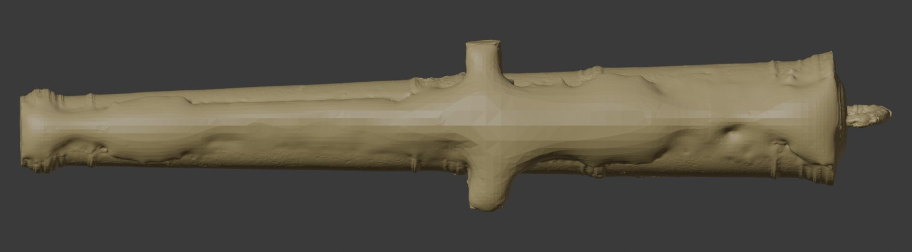 | 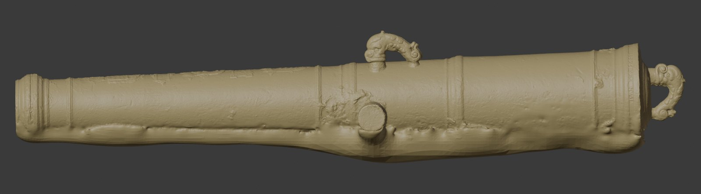 |

**Regla que guió todo el trabajo:** *no inventar*. Cada superficie recreada tenía que salir de algo **medido** en el propio cañón.

## 2. Medir el cañón en vez de inventarlo

1. **Alineado:** el escaneo original se alineó con la reconstrucción (ICP de traslación, error mediano de 0,027 mm). Así se sabe qué partes son dato real y cuáles inventadas.
2. **Eje real:** en cada rodaja de 1 mm se ajusta un círculo robusto y se obtiene un **eje curvo** (polinomio de grado 3). El cañón no es perfectamente recto.
3. **Perfil de revolución:** el radio se mide en función de la posición a lo largo del eje, pero solo en los sectores laterales bien escaneados (35° a 88° desde arriba), con rodajas de 0,02 mm. En el gráfico, las curvas de los distintos sectores coinciden casi perfectamente: el brocal, los anillos y las molduras de la culata son **de revolución**.

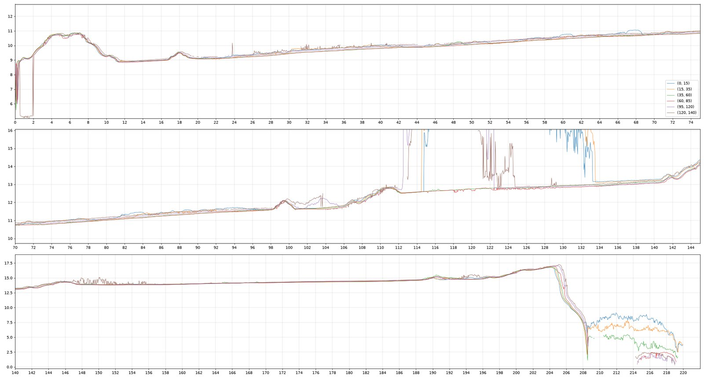

4. **Suavizado adaptativo:** fuerte en los tramos lisos (para que no queden "rayas") y ligero en los anillos (para conservar sus cantos). Después se afila el perfil medido para que las molduras tengan el canto marcado.

## 3. Rellenar la parte de abajo con la forma real

- Se quitan los puntos sin dato (por debajo de 112° desde arriba).
- Se generan puntos **girando el perfil medido** sobre el eje real.
- En la banda de unión (95° a 112°), los puntos reales se acercan al perfil quitándoles **solo los bultos**; la textura se conserva.
- **Muñones:** se ajusta un cilindro con la mitad de arriba, que es real, y se recrean la mitad de abajo y la cara extrema.
- **Plato trasero:** el escáner sí lo vio por detrás. Se conservan sus datos y solo se recrea el canto, que había quedado en láminas sueltas.
- Se vuelve a cerrar todo con Poisson apantallado y, en las zonas recreadas, los vértices se proyectan **exactamente** sobre la superficie de revolución. Eso elimina el escalonado de la rejilla.

| 1.ª versión: forma correcta pero lisa | Final |
|---|---|
| 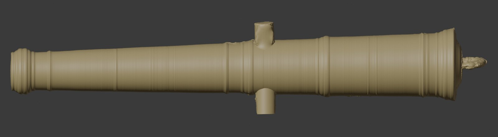 | 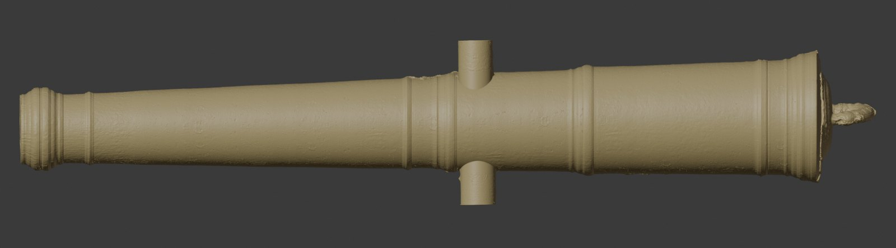 |

**Plato trasero:** en el escaneo, el canto del plato quedó como láminas sueltas. Se eliminó todo el canto y se recreó en el contorno completo con el perfil medido. La textura se proyecta según la longitud de arco sobre el perfil, porque proyectarla según la posición a lo largo del eje dejaba rayas radiales en la cara vertical.

| Antes (arriba e izquierda) / después (derecha) | Plato final |
|---|---|
| 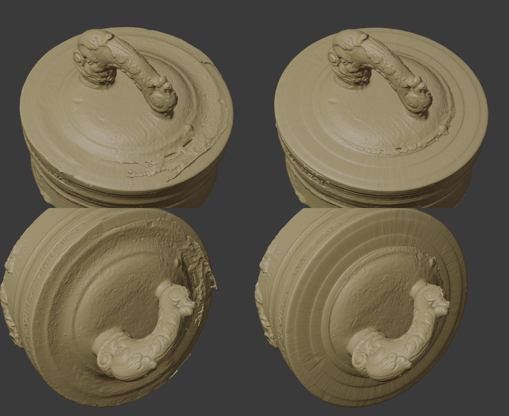 | 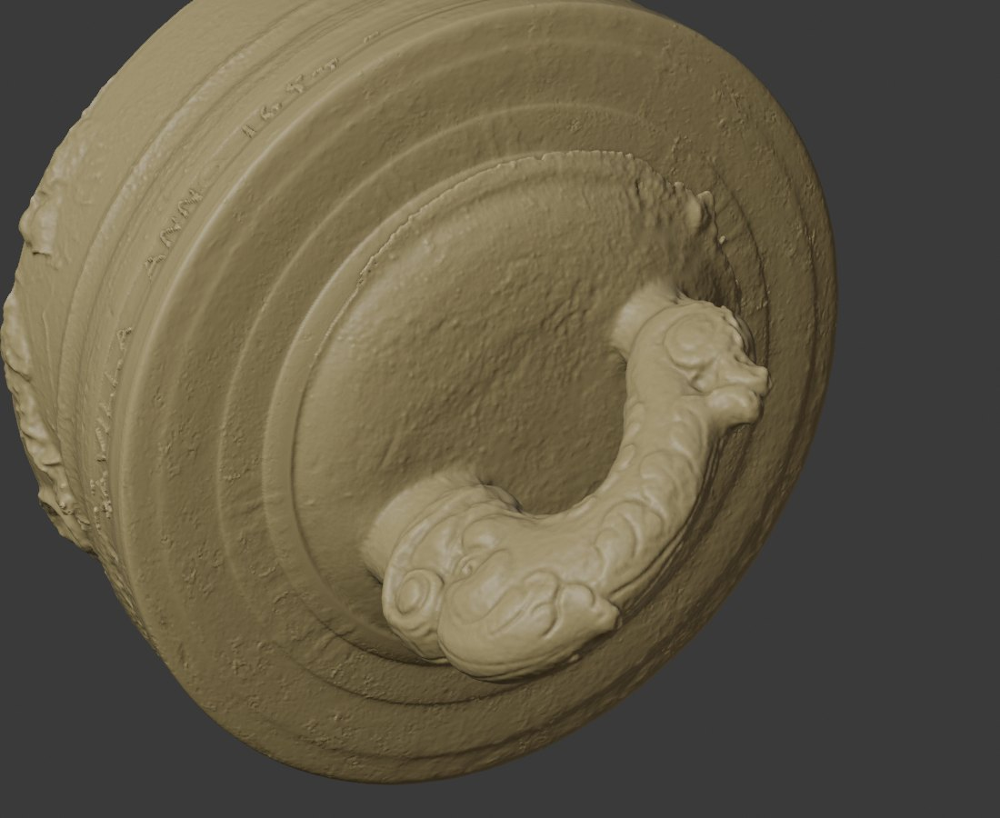 |

En la **cúpula trasera** el escaneo tiene menos datos y su borde está deshilachado. Ahí el corte sube a 80° desde arriba, se protege solo el volumen del cascabel y se alisan las láminas sueltas que quedan cerca (`cupula_post.py`):

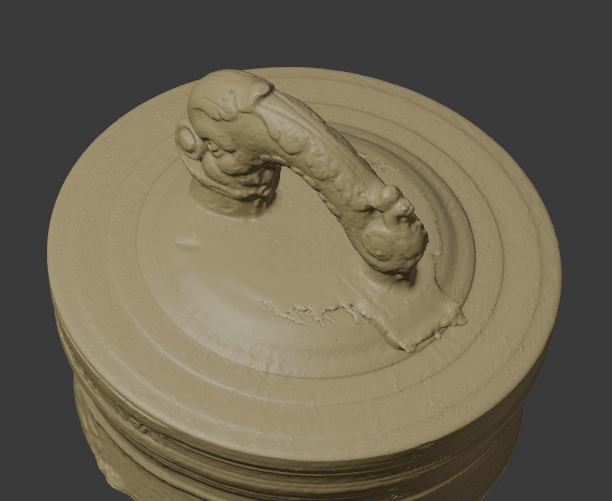

Las **molduras** se afilan con una máscara de enfoque aplicada al perfil medido (σ 0,12 mm), en todo el contorno, para que los anillos tengan el canto marcado:

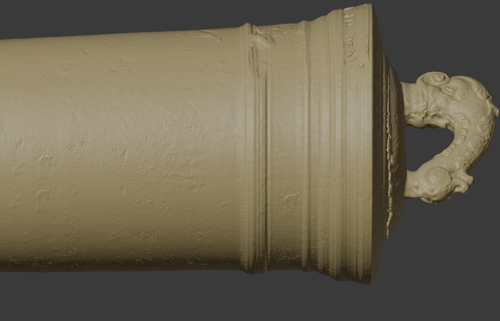

## 4. Trasplantar la textura real de la corrosión

Una superficie recreada lisa se ve "de plástico" junto al bronce corroído. Para evitarlo:
1. Se despliega el cañón en un mapa plano (x, ángulo) y se separa el **detalle fino** (de menos de 1 mm: poros y corrosión) de los **bultos** (de más de 1 mm). En este mapa aparecieron, de paso, las inscripciones (ver §6).
2. La textura de abajo se compone con **parches aleatorios** sacados de dos zonas donantes limpias, de corrosión uniforme. La mezcla entre parches conserva la intensidad y no se ven repeticiones.
3. Junto a la costura se hace un fundido ancho, de unos 12°, y antes se aplica un filtro de mediana que quita el moteado del borde del escaneo.

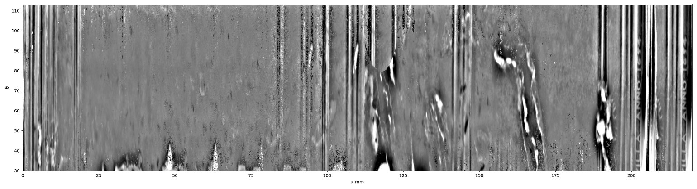

## 5. Los delfines: dos asas gemelas, un solo molde

- Las dos asas del cañón salieron **del mismo molde**, espejadas. Al reflejar una y alinearla (ICP) sobre la otra, coinciden con una diferencia mediana de **0,08 mm**. Lo que las distingue son concreciones marinas y desgaste.
- **Consenso:** cada asa conserva su malla y sus vértices se desplazan sobre la normal hacia el consenso con su gemela:
  - donde coinciden, se toma el promedio (menos ruido);
  - donde una tiene un grumo localizado, se hunde hasta la otra.
  - El campo de desplazamiento se suaviza para no crear pliegues.
- **Cascabel:** es simétrico de izquierda a derecha (está girado unos 7° sobre el eje, como en la pieza real), así que se aplica el mismo consenso con su propio reflejo.

| Diferencias entre las gemelas | Antes / después del consenso |
|---|---|
| 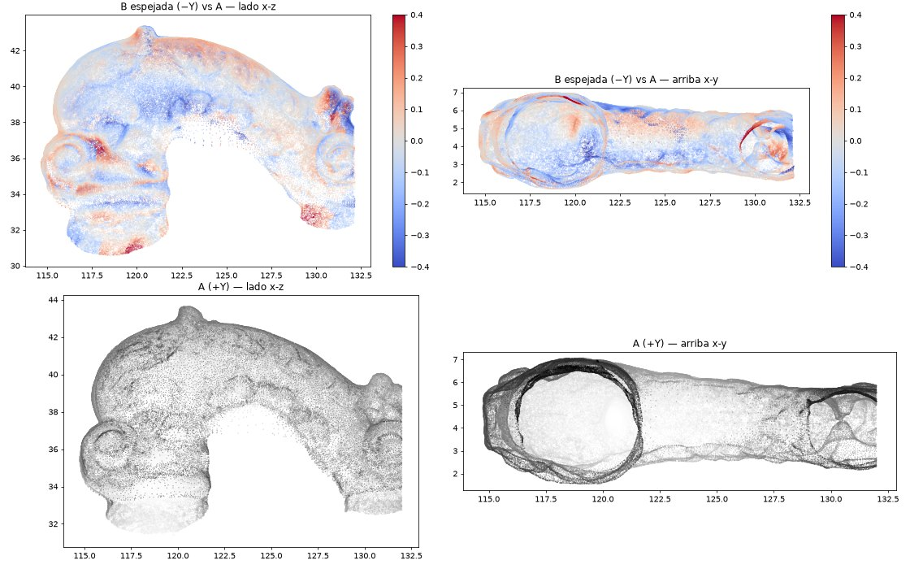 | 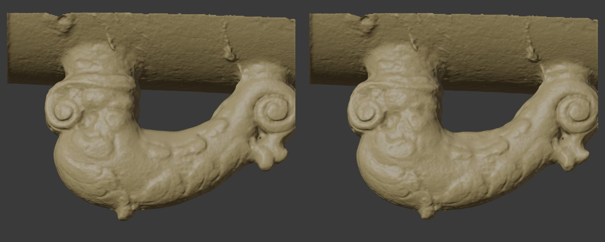 |

**Hallazgo importante:** la blandura del relieve **no** se debe al proceso. Al comparar el escaneo crudo, Poisson y el consenso, los tres tienen el mismo nivel de detalle. Es el límite de resolución del escáner a esta escala.

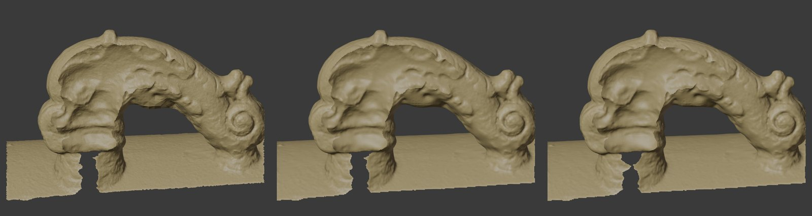

Se probaron varios tratamientos de "metal fundido" (superficie lisa con aristas definidas). Los que conservan aristas pero son agresivos (A y B) **borraban detalle real** y se descartaron. Se conservaron las variantes **C** (suave) y **D** (laplaciano HC y realce de la banda media), que conservan todo el detalle.

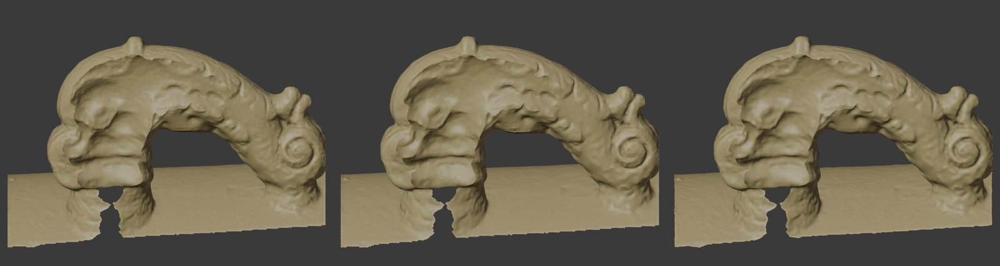

## 6. Leer lo que no se ve: inscripciones y escudos

**Técnica:** se despliega la superficie en un plano a 0,02 mm, se quita la forma del cañón (paso alto), se aplica **contraste local** y se sombrea con **luz rasante** a 25° desde cuatro direcciones. Es la versión digital de la fotografía con luz rasante que se usa en epigrafía.

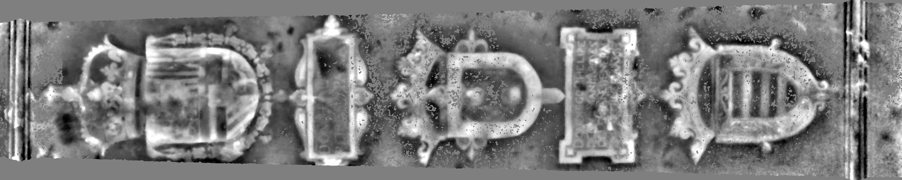

- **Culata:** «IVAN TER HORST ME FE[CIT]» y «…VILLA ANNO **1654**». El año no se leía en la pieza ni en las fotos. La tercera cifra es probablemente un 5 (podría ser un 3).

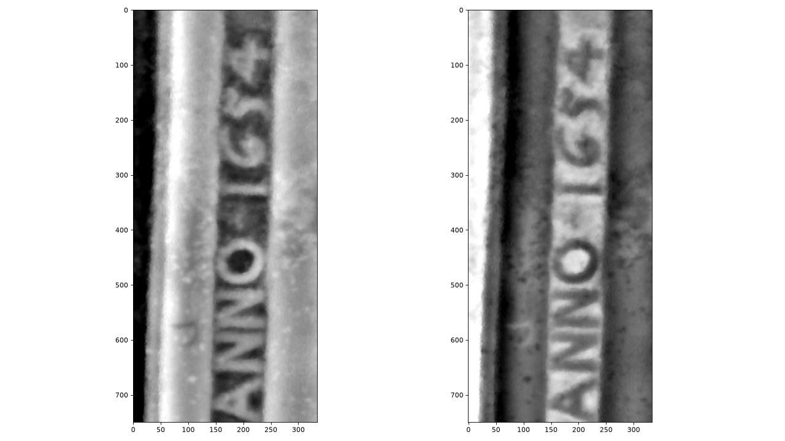

- **Placa rectangular:** «**DON DIEGO PHELIPE** / …[GV]ZMAN MARQ… / …[LEG]AN[ES]…». Se comparó con la placa de otro cañón de la época, que lleva la fórmula completa: «DON DIEGO PHELIPPE DE GVZMAN MARQVES DE LEGANES CAPITAN GENERAL DE LA ARTILLERIA DE ESPAÑA…». Con eso la placa se identifica con **don Diego Felipe de Guzmán, I marqués de Leganés**, Capitán General de la Artillería de España hasta 1655, lo que **encaja con el año 1654** de la culata.

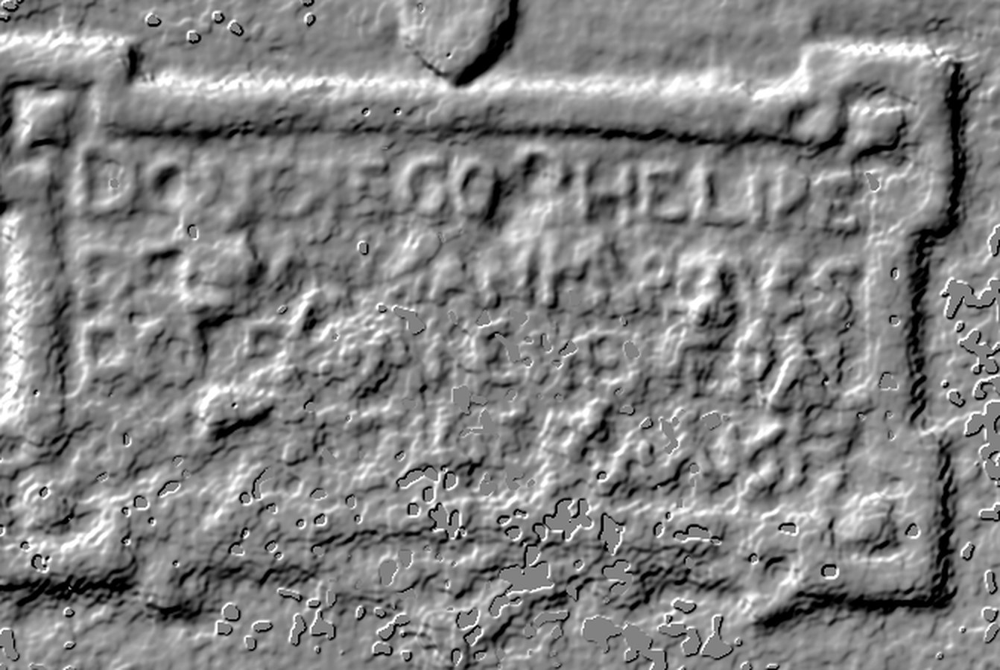

**Mejora de los textos legibles:** en la inscripción de la culata, el relieve medido de cada letra se convierte en una meseta con canto vivo **en su posición exacta**, sin tipografía externa. Se descartan las manchas pequeñas (corrosión) y las crestas largas (cantos de molduras).

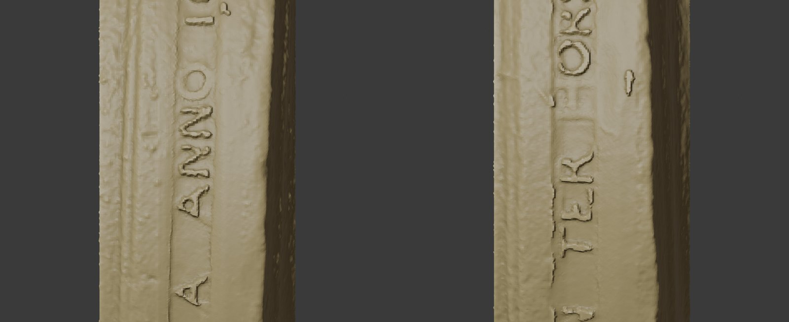

Los escudos reciben un **realce del relieve medido, sin suavizar**: el suavizado empeoraba la lectura de las letras.

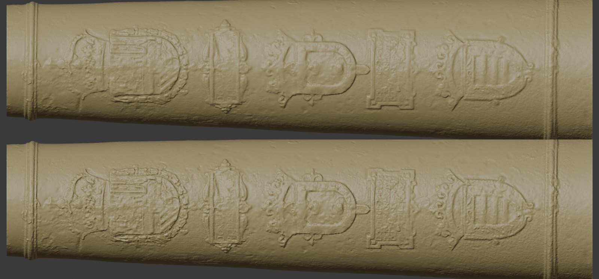

## 7. Hallazgos

| Hallazgo | Confianza | Evidencia |
|---|---|---|
| Año de fundición **1654** (culata) | **Confirmado**: coincide con la lectura oficial de los sellos (Sevilla, 1654) | Mapa de relieve con paso alto |
| Fundidor **Ivan (Jan) ter Horst**, Sevilla | Alta en la lectura; probablemente el «Juan Fers Hors» de los cañones de Tenerife de 1651 y 1653 | Inscripción de la culata |
| Placa del **marqués de Leganés**, Capitán General de la Artillería | Alta en el renglón 1; la fórmula, por comparación | Luz rasante + placa de referencia de otro cañón |
| Escudo con arco junto a la placa: armas de los Guzmán (Leganés) | Media | Posición y fórmula |
| Las dos asas proceden del mismo molde | Alta | Diferencia mediana de 0,08 mm tras el ICP |
| El cascabel está girado unos 7° sobre el eje | Alta | Simetría por ICP |

La validación con fuentes públicas está en [docs/VALIDACION_HISTORICA.md](docs/VALIDACION_HISTORICA.md).

## 8. Lo que no funcionó (y por qué)

- **Rellenar agujeros "a la fuerza"** (Blender, vóxeles): dejaba aristas no-manifold o atravesaba el interior.
- **Textura con deformación senoidal:** creaba un veteado en zigzag, como de madera.
- **Reflejar la textura junto a la costura:** copiaba el ruido del borde del escaneo y, de paso, letras.
- **Mezclar las dos asas como nubes de puntos:** producía una superficie rugosa, como de corteza. Por eso se pasó al desplazamiento por consenso.
- **Suavizado agresivo que conserva aristas** (A y B): borraba volutas y espirales del molde.
- **Restaurar la placa completa con la fórmula:** la placa tiene solo 4 renglones, así que el texto va **abreviado**. La correlación con candidatas **no distingue** ni siquiera el renglón legible, de modo que se decidió **no tallar letras adivinadas**.

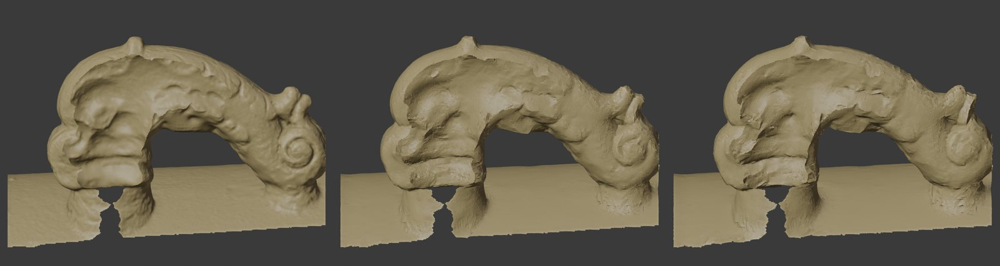

## 9. Reproducir el método

Requisitos: `pip install -r requirements.txt` y Blender 4.4 o 5.0 para los renders. Orden aproximado (ver los comentarios de cada script):

| Paso | Script |
|---|---|
| Limpieza y Poisson inicial | `poisson.py` |
| Alineado del escaneo con la reconstrucción | `fondo_analisis.py`, `analisis_realign.py` |
| Eje, perfil y muñones | `analisis_axis.py`, `analisis_profile.py`, `perfil_final.py`, `perfil_adaptativo.py`, `analisis_trun.py` |
| Mapa de textura | `textura.py` |
| Reconstrucción del fondo, muñones y canto | `fondo_revolucion.py` (`--sin-delfines --fiel`) |
| Delfines (consenso + metal C/D) | `delfines_post.py` (`--metal=C|D`), `delfines_consenso.py`, `metal2.py` |
| Escudos (realce del relieve medido) | `escudos_post.py` |
| Textos con cantos vivos | `textos_post.py` |
| Análisis de inscripciones | `escudos_mapas.py`, `placa_lectura.py` |
| Exportación (MAXIMO, 4M, 300k, 100k) | `export.py` |
| Renders y visor web | `render_*.py`, `visor_zonas.py` |

> **Aviso:** PyMeshLab no guarda en rutas con caracteres no ASCII (por ejemplo, «ñ»). Hay que trabajar en una carpeta sin acentos.

## 10. Límites, ética y datos

- **No se publican** ni el escaneo ni las mallas: es una pieza del patrimonio cultural de Colombia y el trabajo es un encargo de cliente. Este repositorio documenta el **método** y sus resultados visuales.
- **Fotos de prensa:** no se incluyen porque tienen derechos de autor. Las fuentes están más abajo.
- Las lecturas epigráficas son **hipótesis de trabajo** basadas en el escaneo. Las tiene que confirmar un especialista (ICANH o un historiador de la artillería).
- Las superficies recreadas (la parte de abajo, la mitad inferior de los muñones y el canto del plato) **no son dato del escaneo**. Se generaron a partir de la geometría medida en la misma pieza y están marcadas en las imágenes de diagnóstico.

**Fuentes de contexto:** [Radio Nacional](https://www.radionacional.co/cultura/galeon-san-jose-primeras-piezas-recuperadas-por-colombia-tras-317-anos) · [Noticias Caracol](https://www.noticiascaracol.com/colombia/fotos-gobierno-de-colombia-recupera-las-primeras-cinco-piezas-del-galeon-san-jose-cuales-son-cb20) · [Blu Radio](https://www.bluradio.com/sociedad/cultura/esta-es-la-historia-de-los-objetos-extraidos-del-galeon-san-jose-pr30) · [Henryck ter Horst (Science Museum Group)](https://collection.sciencemuseumgroup.org.uk/people/cp993)
